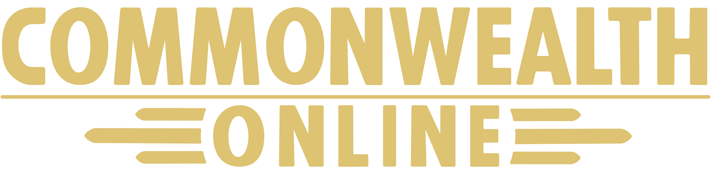

<p align="center">
  
</p>

**Dedicated-server Fallout 4 multiplayer** — not campaign co-op, not an MMO.

Commonwealth Online is an active Fallout 4 multiplayer mod built around an external **native C++ dedicated server** (Minecraft-style hosting: run the server, clients connect). Each player still runs a full local Fallout 4 instance; the server coordinates and relays state — it does not simulate the Commonwealth.

The project has moved past the initial research prototype. Connected clients **see other players** as runtime proxy actors in the same cell, with movement, locomotion animation, appearance, apparel, and partial weapon visuals.

Gameplay systems are built on that foundation, but they are **not all in a release build**. The repository contains a **native authoritative server**, **Protocol V2 identity and resume** (`co-core/src/session/`), **ranged player combat actions** (`CO-BETA/plugin/src/F4TRangedCombatCapture.cpp`), **owned-inventory snapshots and drop/pickup deltas** with the server as the only writer of the balance (`CO-BETA/docs/protocol/inventory.md`), and **host-authoritative NPC sync with server-side NPC hit validation** (`CO-BETA/plugin/src/F4TNpcSync*.cpp`, `CO-SERVER/server-cpp/src/ServerNpcHitImpl.inc`).

**Most of that gameplay work is not yet verified in game.** NPC sync, inventory sync and the other feature paths are compiled into every build with no test-features switch. The unverified paths are listed in [`docs/limitations.md`](docs/limitations.md); see the code notes in [`../docs/code-notes/`](../docs/code-notes/).

**Design target:** larger dedicated-server sessions (**16+ players** near full release). **Current limit:** up to **15 visible remote proxy actors per client** (`kMaxRuntimeProxyActors`, a 16-player session minus the local player); remote players must be in the **same loaded cell** to appear.

For how this project relates to **DoxyCoSync** (peer-to-peer co-op for small groups), see [`docs/project-comparison.md`](docs/project-comparison.md). The creators collaborate on research; the mods are separate products for different scales and architectures.

---

## Project status

### Working today

- **Native C++ dedicated server** — `CO-SERVER/server-cpp/`, the authoritative server (GameNetworkingSockets transport)
- **Protocol V2 identity** — hello and identity validation must complete before gameplay (`CO-SERVER/server-cpp/src/IdentityGate.cpp`; `require_v2_identity` cannot be disabled, `CO-SERVER/server-cpp/src/ServerConfiguration.cpp`)
- **UDP LAN discovery** — port `7778`; clients can find local servers without hard-coded addresses
- **Protocol lifecycle** — `welcome`, `transform`, `disconnect`, late-join snapshot replay, optional `worldState` / `serverWorldState`
- **Transform sync** — position, heading, cell/worldspace, movement fields (`isMoving`, sprint, sneak, jump, `weaponDrawn`, speed); ~10 Hz while moving
- **Runtime proxy actors** — PlaceAtMe-backed visual puppets per remote `playerId`; movement smoothing; passive/neutralized (not shared combat actors)
- **Locomotion animation** — curated animation-graph variables and transition events from remote movement state
- **Appearance sync** — height, body morph, hair colours, head parts, morph sliders, tints, complexion (best-effort on proxies; gender/race switching deferred)
- **Visible apparel sync** — equipped clothing, armor, hats, eyewear via `equippedItems`
- **Weapon visuals (partial)** — right-hand weapon model sync and weapon-drawn animation path for ranged guns; reliability still being tested in-game
- **Shared time and weather** — designated world-state host relays time/weather
- **Session onboarding** — first-time join via **Vault111Cryo** (solo during character creation), quest-owned Looks/SPECIAL flow, server profile ↔ save binding, reconnect handling
- **Main-menu multiplayer UI** — runtime **Multiplayer** row injection (no patched `MainMenu.swf`); PrismaUI server browser with keyboard and gamepad support
- **LAN server browser tab** — discovers servers on the local network
- **Dev tooling** — build/deploy batch scripts

### In progress / experimental

- **NPC authority and combat state** — server-side validation (`CO-SERVER/server-cpp/src/ServerNpcHitImpl.inc`); client NPC sync and client loot are compiled into every build, with no test-features switch (`CO-BETA/plugin/xmake.lua`)
- **NPC co-op shared health** — shared NPC health on the npcHit path (`CO-SERVER/server-cpp/src/ServerNpcHitImpl.inc`, `FindFreshNpc` stored health/maxHealth); plugin contract `CO-BETA/plugin/tests/F4TNpcCoopHealthContract.py`
- **Player factions** — UI, plugin client and server are on `nomad-dev` (merged via #282); not yet verified in game
- **Weapon-drawn animation reliability** — draw/holster/armed locomotion on proxies; ongoing fixes and diagnostic work (see `docs/archive/dev-log.md`)
- **Vault 111 character onboarding** — `CO_CharacterSetupQuest` owns placement, Looks/SPECIAL setup, and completion; flow polish and testing continue
- **Server browser (Browse tab)** — loads the public directory from `https://commonwealth-online.com/servers/server.json`, then TCP-probes each host for connect ping. **Local tab** remains the LAN discovery path. Player counts are not live yet.
- **Player chat** — plugin, server and UI paths are in the tree (`CO-BETA/plugin/src/F4TChat.cpp`, `CO-SERVER/server-cpp/src/ServerChat.cpp`, `CommonwealthOnlineUI/src/F4TChatView.cpp`); the chat UI has not been run in game ([`docs/protocol/chat.md`](docs/protocol/chat.md))
- **Identity, persistence and server-side validation** — server-issued per-server profile IDs, mandatory Protocol V2 identity, resume tokens (default lifetime 720 h) and an optional server password checked as a SHA-256 digest in the hello; durable state is on in the packaged config (`enable_persistence`) and writes atomically with a backup. The server validates player state and rejects malformed, stale or unauthorised state before storing it ([`../docs/server/IDENTITY.md`](../docs/server/IDENTITY.md), [`../docs/server/PERSISTENCE.md`](../docs/server/PERSISTENCE.md))

### Planned direction

- **Playable vertical slice** — onboarding into shared-world presence, then expanding gameplay sync over time
- **Scale toward 16+ player sessions** — protocol and server default to 16 max players; not load-tested at that scale yet
- **Weapon sync phase 2** — melee, fire events, ADS (see `docs/weapon-animation-sync.md`)
- **Power armor and fuller weapon state**
- **Live server directory probes** — player counts, ping, and richer browse metadata beyond the static `server.json` list

### Possible future direction

- Public testing or beta (no committed schedule documented yet)
- Simple co-op combat arena or map-focused session modes
- Broader mod compatibility (clean load order required today)
- GOG support (Steam is the primary tested platform)

### Out of scope (current stage)

- Full Fallout 4 **campaign co-op**
- **Workshop building**, **VATS**, **companion**, **dialogue** and **player trading/container** synchronization (quest sync and settlement capture have code but are not yet verified in game; VATS has a server policy only, see [`docs/limitations.md`](docs/limitations.md))
- **Headless server-hosted** Fallout simulation (each client owns its own world)
- **MMO-scale** public matchmaking or persistent MMO gameplay
- **Microsoft Store / Game Pass** and **console**
- **Large modlist** compatibility

---

## Architecture at a glance

```text
Fallout 4 + F4SE Plugin  ←—— GNS/UDP (7777) ——→  Native Dedicated Server  ←——→  Other Clients
                                    ↑
                           UDP LAN discovery (7778)
```

1. The plugin reads local player transform and optional appearance/equipment snapshots.
2. The native server assigns `playerId` on connect (`CO-SERVER/server-cpp/src/ServerProtocolImpl.inc`, `HandleConnected`), stamps `serverTime`, and broadcasts to other clients.
3. Each client spawns **local runtime proxies** for remote players in the **same cell** — visual mirrors, not full networked player entities.

Details: [`docs/architecture.md`](docs/architecture.md) · Protocol: [`docs/protocol.md`](docs/protocol.md) · Server: [`../CO-SERVER/README.md`](../CO-SERVER/README.md)

---

## Quick start (developers)

```bat
git clone <repo-url>
cd Commonwealth-Online
git submodule update --init --recursive
build-all.bat
```

Start a server: build and run the native dedicated server from
[`../CO-SERVER`](../CO-SERVER/README.md), or point the client at an existing one.

Deploy into a Fallout 4 install (prompts for path on first run):

```bat
deploy-all.bat
```

Launch Fallout 4 through F4SE → main menu → **Multiplayer** → **Local** tab (scan for LAN server) or connect to `127.0.0.1:7777`.

Full setup, version pins, and troubleshooting: [`docs/setup.md`](docs/setup.md)

---

## Requirements

| Requirement | Notes |
|---|---|
| Fallout 4 (Steam) | Supported targets: **1.11.240.0 AE**, **1.10.984.0 NG**, **1.10.163.0 OG** ([`docs/version-targets.md`](docs/version-targets.md)) |
| F4SE | Matching runtime-specific versions |
| Address Library for F4SE Plugins | Installed by each player, never shipped with CO. The plugin resolves engine functions from the bin for the running game: `version-1-10-163-0.bin` (OG), `version-1-10-984-0.bin` (NG), `version-1-11-240-0.bin` (AE) in `Data/F4SE/Plugins/`. Names and reference hashes: [`source:CO-BETA/tools/engine-ids.lock.json`](tools/engine-ids.lock.json) |
| Visual Studio 2022+ | C++ plugin build |
| Git | Including submodule support |
| FO4IDE or Creation Kit | Optional Papyrus regeneration only (`compile-papyrus.bat`) |
| Mod manager (optional) | MO2 or Vortex; **clean test profile** strongly recommended |

All connected players should use the same game version, F4SE version, plugin build, ESP versions, and load order.

---

## Repository structure

```text
plugin/           F4SE/CommonLibF4 C++ sync/networking plugin (src, include, tests)
creation-kit/     ESP sources, Papyrus scripts, assets
docs/             Architecture, setup, protocol, dev notes, roadmap
docs/protocol/    Detailed packet and sync field reference
ci/               Release packaging, content staging and protocol-acceptance scripts
tools/            Helper utilities and development scripts
ThirdParty/       Vendored sources (GameNetworkingSockets-src, CommonwealthOnlineUI mirror)
Branding/         Project logos
Licenses/         Third-party license notices
build/            Staged mod output (generated by build-all.bat)
```

UI lives in the tracked top-level `CommonwealthOnlineUI` project (`CommonwealthOnlineUI.dll` + Prisma views). PrismaUI_F4 2.1.0 is an external Ultralight-based prerequisite.

Root batch scripts: `build-all.bat`, `build.bat`, `build-gns-bridge.bat`, `compile-papyrus.bat`, `deploy-all.bat`, `deploy-ui.bat`, `stage-mod.bat`, `launch-two-fallout4.bat`, `resolve-fallout4-path.bat`. Build the UI in `../CommonwealthOnlineUI`; normal package staging uses checked-in PEX outputs. The server and its Host GUI live in [`../CO-SERVER`](../CO-SERVER/README.md).

---

## Documentation

| Document | Purpose |
|---|---|
| [`docs/setup.md`](docs/setup.md) | Build, deploy, submodules, main-menu notes |
| [`docs/architecture.md`](docs/architecture.md) | Plugin, server, proxy, threading model |
| [`docs/protocol.md`](docs/protocol.md) | Message types and LAN discovery |
| [`docs/protocol/`](docs/protocol/) | Detailed packet field reference |
| [`docs/limitations.md`](docs/limitations.md) | Technical limits and unsupported systems |
| [`docs/debug-logging.md`](docs/debug-logging.md) | Beta debug switch, runtime controls, and log collection |
| [`docs/version-targets.md`](docs/version-targets.md) | Supported game/F4SE versions |
| [`docs/project-comparison.md`](docs/project-comparison.md) | Commonwealth Online vs DoxyCoSync |
| [`docs/ROADMAP.md`](docs/ROADMAP.md) | Vertical-slice roadmap and milestones |
| [`changelog.md`](changelog.md) | Record of code and documentation changes |
| [`docs/README.md`](docs/README.md) | Documentation index, and where the archived material sits |

Everything above is a current contract. Historical material lives under [`docs/archive/`](docs/archive/) and is not maintained against the code; [`docs/archive/dev-log.md`](docs/archive/dev-log.md) holds the milestone history, testing notes and next steps by date.

---

Progress was made through human research and repeated in-game testing, runtime logs, and targeted community research. Behaviour should be verified against the game, project documentation such as [`docs/protocol.md`](docs/protocol.md), runtime evidence, and relevant community research before it is considered correct.

---

## Legal notice

Commonwealth Online is an **unofficial fan project**. It is not affiliated with, endorsed by, or associated with Bethesda Softworks or ZeniMax Media.

This repository does **not** include Fallout 4 game files, Bethesda assets, F4SE binaries, Creation Kit binaries, or any proprietary game code. Users must **own Fallout 4** and install F4SE, the Creation Kit, and other required tools themselves.

*Fallout* and related marks are trademarks of Bethesda Softworks LLC.

---

## License

No formal open-source license has been selected. See [`LICENSE`](LICENSE):

> Do not reuse, redistribute, or publish this code/assets until a license is selected.

Third-party dependencies under `ThirdParty/` retain their own licenses.

## Credits

- FathersFallout - Copyright (C) 2026 FatherLamb. The crash-log re-check and early error logging, the previous-session log in Share Log, the remote equipment-change debounce, and the animation graph override subsystem (`F4TAnimationGraphOverride`, ported from `client-ng/src/sync/GraphOverride`) are derived from FathersFallout (GPL-3.0 with additional terms) and used with the author's permission.
